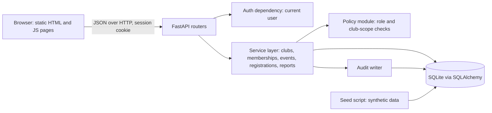
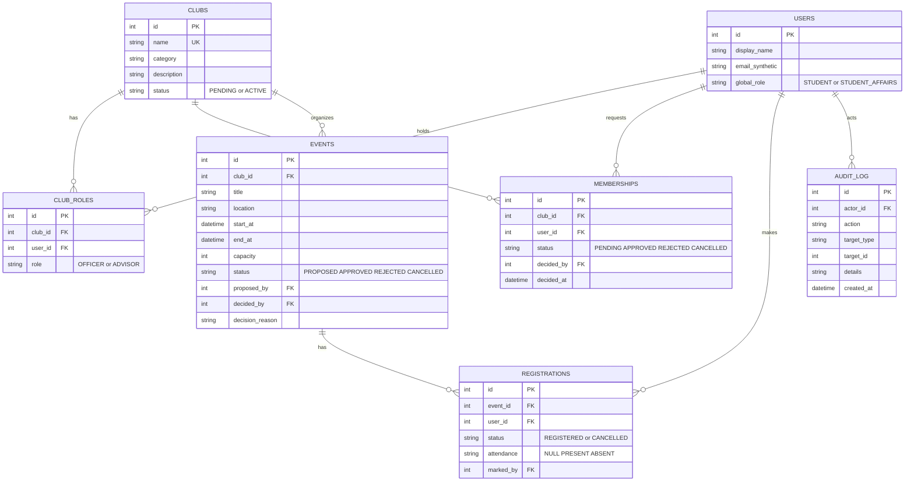

# Design Package: PSU Clubs Hub (Release 1)

## 1. Architecture (component diagram)

Rules: routers contain no business rules. Every service function calls the policy module first (deny by default). Only services touch the database.

## 2. Data model

Integrity rules in the database:
- `CLUB_ROLES`: unique (club_id, user_id, role).
- `MEMBERSHIPS`: at most one PENDING or APPROVED row per (club_id, user_id) (partial unique index).
- `REGISTRATIONS`: unique (event_id, user_id). Re-registering after a cancel reactivates the same row, which keeps the duplicate rule simple and race-safe.
- Capacity is checked inside a transaction that counts REGISTERED rows (see risk R5).

## 3. Role and permission matrix
Club-scoped means: only for clubs where the user has that role in `CLUB_ROLES`.

| Action | Student | Officer | Advisor | SA |
|---|---|---|---|---|
| Sign in (simulated) | yes | yes | yes | yes |
| Search ACTIVE clubs, view profile | yes | yes | yes | yes |
| View PENDING clubs | no | no | no | yes |
| Create, activate club, assign roles | no | no | no | yes |
| Edit club profile | no | own club | no | yes |
| Request membership | yes | yes (not decide own) | yes | yes |
| Decide membership requests | no | own club | no | no |
| View own memberships, cancel own pending | yes | yes | yes | yes |
| Propose event | no | own club | no | no |
| Decide event proposal | no | no | no | yes |
| Cancel event | no | own club | no | yes |
| List approved upcoming events | yes | yes | yes | yes |
| View PROPOSED events | no | own club | own club (read) | yes |
| Register for or cancel registration for an event | yes | yes | yes | yes |
| Mark attendance | no | own club | no | no |
| View own attendance | yes | yes | yes | yes |
| View summary report | no | no | no | yes |

## 4. State machines
- Membership: PENDING to APPROVED or REJECTED (officer). PENDING to CANCELLED (student). Other transitions are refused with 409.
- Event: PROPOSED to APPROVED or REJECTED (SA). PROPOSED or APPROVED to CANCELLED (officer or SA).
- Registration: REGISTERED to CANCELLED, and back to REGISTERED only through a new valid registration.

## 5. API contract (JSON, prefix `/api`)
| Method and path | Role | Success | Errors |
|---|---|---|---|
| POST `/auth/login` {user_id} (simulated, enabled by config only) | any | 200 + session cookie | 404 unknown user |
| POST `/auth/logout` | any | 204 | 401 |
| GET `/me` | any | 200 user + club roles | 401 |
| GET `/clubs?q=&category=` | any | 200 list | 401 |
| GET `/clubs/{id}` | any | 200 | 401, 404 |
| POST `/clubs` | SA | 201 | 401, 403, 422 |
| POST `/clubs/{id}/activate` | SA | 200 | 401, 403, 404, 409 |
| POST `/clubs/{id}/roles` {user_id, role} | SA | 201 | 401, 403, 404, 409, 422 |
| PATCH `/clubs/{id}` | officer own club, SA | 200 | 401, 403, 404, 422 |
| POST `/clubs/{id}/membership-requests` | student | 201 | 401, 404, 409 |
| GET `/clubs/{id}/membership-requests` | officer own club | 200 | 401, 403, 404 |
| POST `/membership-requests/{id}/decision` {decision} | officer own club | 200 | 401, 403, 404, 409 |
| GET `/me/memberships` | any | 200 | 401 |
| DELETE `/membership-requests/{id}` | owner | 204 | 401, 403, 404, 409 |
| POST `/clubs/{id}/events` | officer own club | 201 | 401, 403, 404, 422 |
| POST `/events/{id}/decision` {decision, reason} | SA | 200 | 401, 403, 404, 409, 422 |
| POST `/events/{id}/cancel` | officer own club, SA | 200 | 401, 403, 404, 409 |
| GET `/events` | any (filtered by role) | 200 | 401 |
| POST `/events/{id}/registrations` | any signed-in student | 201 | 401, 404, 409 |
| DELETE `/events/{id}/registrations/me` | owner | 204 | 401, 404, 409 |
| PUT `/events/{id}/attendance/{user_id}` {status} | officer own club | 200 | 401, 403, 404, 409 |
| GET `/me/attendance` | any | 200 | 401 |
| GET `/reports/summary` | SA | 200 | 401, 403 |

Conventions: the server derives the acting user from the session only. Request bodies are validated with schemas that reject unknown fields (stops over-posting of `role`, `status`, `decided_by`).

## 6. Security, privacy, accessibility
| Topic | Threat or concern | Design response |
|---|---|---|
| Broken access control | Officer acts on another club by guessing IDs | Policy module checks club scope on every call, tests per endpoint (AC-07, AC-13, AC-18, AC-20, AC-29) |
| Client-side only checks | Hidden buttons are not security | Server enforces all rules. UI hiding is cosmetic only |
| Privilege escalation | Role or status in the request body | Strict schemas, roles from DB only (AC-02) |
| Session and CSRF | Cookie-based session | Signed cookie, `HttpOnly`, `SameSite=Lax`, JSON-only bodies, secret from environment |
| Simulated login | Login without a password must never reach production | Enabled only by `SIMULATED_AUTH=true`. Documented as a handoff item for PSU IT |
| Race conditions | Double registration, overbooking | Unique constraint plus transactional capacity check (AC-25, AC-26) |
| Privacy | Personal data in logs, demos, repo | Synthetic users only, log IDs not names, no secrets committed (AC-33) |
| Audit integrity | Tampering with history | Append-only: no update or delete endpoint (AC-32) |
| Accessibility | Unlabelled forms, keyboard traps | Semantic HTML, labels, visible focus, contrast, no colour-only status, checklist (AC-34) |

## 7. Designed for change
| Possible change | Where it fits |
|---|---|
| Advisor approval stage | Add an `ADVISOR_REVIEW` event status and an `event_decisions` stage field. Decision logic is in one service function |
| Duplicate registration prevention | Already enforced in release 1 (AC-25). A change request would extend or tighten it |
| Club inactive status | `clubs.status` is a string. Add INACTIVE and one check in the policy module |
| Audit report | `audit_log` is already written for all actions. Add a read endpoint and filters for SA |
